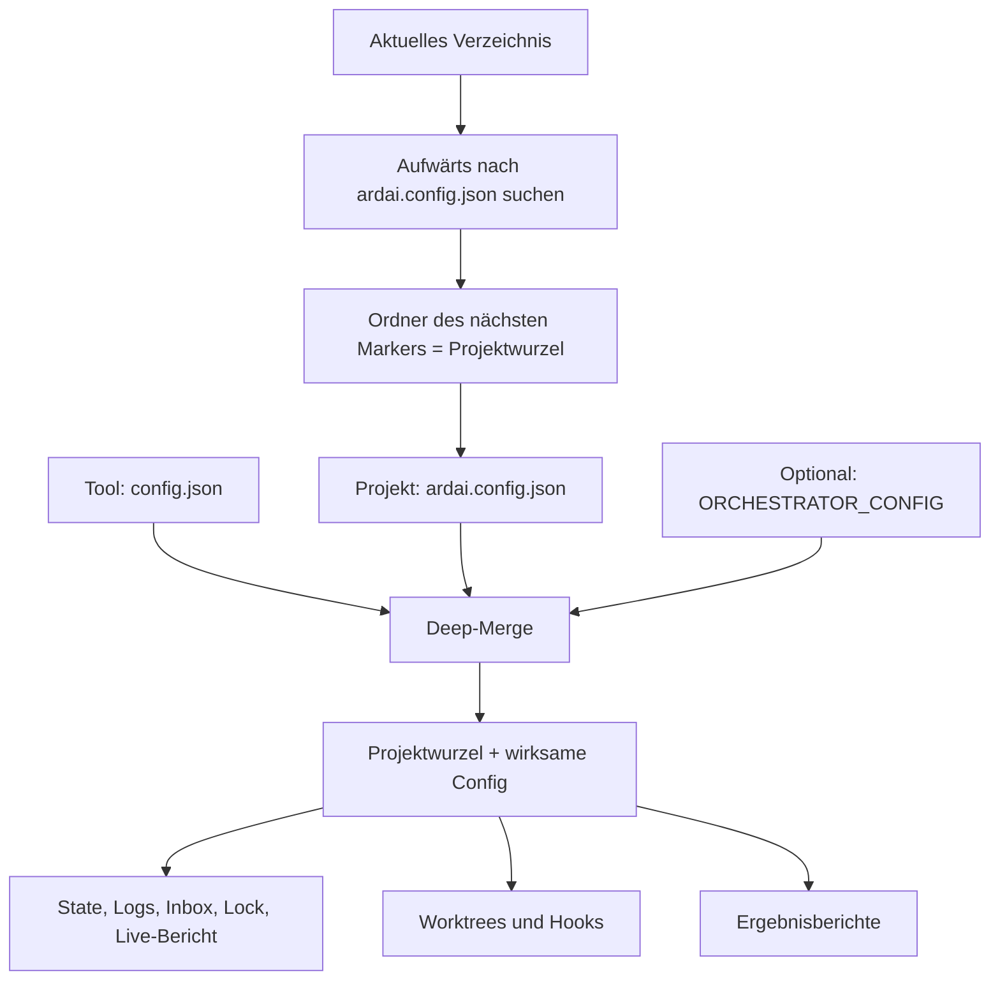

# Projekt-Config und Datenformat

## Projekt finden und konfigurieren

Der erste Ordner mit `ardai.config.json`, vom aktuellen Arbeitsverzeichnis
aufwärts gesucht, ist die Projektwurzel. Eine verschachtelte Projekt-Config
beginnt ein eigenes Projekt; die Config darüber wird nicht zusätzlich geladen.
Ohne Marker bricht ardai mit einem Hinweis auf `ardai init` ab.
`ORCHESTRATOR_CONFIG` ersetzt den Projektmarker nicht.

`ardai init` erstellt einen fehlenden Marker im aktuellen Verzeichnis:

```json
{
  "schemaVersion": 2
}
```

Das reicht, um die Tool-Defaults zu verwenden. Vor `init` projektspezifische
Werte ergänzen: Es installiert den Hook, erstellt den Integration-Branch und
die Worktrees und versucht, den Integration-Branch zum Remote zu pushen.
Ein erster Git-Commit muss vorhanden sein. `install-cli` installiert nur den
Launcher und benötigt keinen Projektmarker.



Priorität, aufsteigend: Tool-Defaults in `config.json`,
Projekt-Config, optionale Datei aus `ORCHESTRATOR_CONFIG`. Objekte werden
rekursiv zusammengeführt. Arrays und skalare Werte werden vollständig ersetzt;
`false`, leere Arrays und `null` sind explizite Überschreibungen. `null` ist
allerdings nur dort sinnvoll, wo die jeweilige Option es unterstützt.
Zum Beispiel behält `{"ui":{"port":4800}}` den Default `ui.enabled: true`.
Ein Agent wird mit `{"agents":{"codex":{"enabled":false}}}` deaktiviert.

Ein relativer Dateiname in `ORCHESTRATOR_CONFIG` bezieht sich auf das aktuelle
Arbeitsverzeichnis beim Aufruf. Pfade **in** dieser Datei beziehen sich wie
alle anderen Projektpfade auf die gefundene Projektwurzel. Fehlende Dateien,
ungültiges JSON und unbekannte Schema-Versionen führen zum Abbruch.

Die Markenfelder (`brand`) sowie CLI-Aliase und kompatible Config-/Protokoll-
und Stopp-Label-Namen beschreibt [Branding](README.md#branding). Ein explizites
`runtimeDir` hat Vorrang vor `brand.runtimeDir`.

## Pfad-Referenz

| Option | Tool-Default | Bedeutung |
| --- | --- | --- |
| `runtimeDir` | `.orchestrator` | Verzeichnis für alle zentralen Laufzeitdateien |
| `resultsDir` | `.orchestrator/results` | HTML-Momentaufnahmen der Testergebnisse |
| `worktreeRoot` | `../ardai-worktrees` | Git-Worktrees `<worktreeRoot>/<agent>` und `integration` |
| `hooks.prePush` | `null` | Eigener Hook relativ zur Projektwurzel; `null` verwendet den mitgelieferten Hook |
| `contextDocs[].path` | keine Dokumente | Projektdateien, die Agenten als Kontext erhalten |
| `protocolAddendum` | `ardai.protocol.md` (Branding siehe unten) | Optionaler Protokoll-Zusatz relativ zur Projektwurzel |
| `phaseTestLocalSecrets` | `null` | Keine Secrets; optional relativer Projektpfad, der in denselben Pfad im Phasentest-Worktree kopiert wird |

`runtimeDir`, `resultsDir`, `worktreeRoot` und ein eigener Hook können auch
absolute Pfade enthalten. Unter `runtimeDir` liegen `state.json`, `logs/`,
`inbox.jsonl`, `run.lock`, `runner.log`, `report.html`, `hints.md`, temporäre
Importdateien und `source-actions/`. Das Hook-Ziel bestimmt Git über
`git rev-parse --git-path hooks/pre-push`; dadurch funktionieren auch
`core.hooksPath` und verknüpfte Worktrees mit einer `.git`-Datei.
Der Standard-Hook bekommt bei `init` den absoluten `worktreeRoot` shell-sicher
eingetragen. Er sperrt Main-Pushes unter diesem Pfad, aus verknüpften Worktrees und
aus Agentenprozessen (`ORCHESTRATOR_AGENT`). Menschliche Pushes aus dem
Hauptverzeichnis bleiben erlaubt. Nach einer Änderung von `worktreeRoot` erneut
`ardai init` ausführen. Eigene Hooks werden unverändert kopiert.
Die Aktivitätsanzeige entfernt den konfigurierten absoluten Worktree-Pfad samt
Agentenverzeichnis aus Windows- und POSIX-Pfaden; andere Pfade bleiben vollständig.

`phaseTestLocalSecrets` erlaubt nur relative Verzeichnisse innerhalb des Projekts,
ohne `.`-/`..`-Segmente. Vor der Kopie muss der Zielpfad per Git ignoriert sein.
Nur wenn Secrets bereitgestellt wurden, nennt der Phasentest-Prompt den
konfigurierten Pfad und erlaubt dessen Nutzung. Nach dem Lauf wird er entfernt.
Nur mitgelieferte Tool-Ressourcen (Defaults, Standard-Hook und Arbeitsprotokoll)
werden relativ zum Tool selbst geladen.

Agenten schreiben weiterhin `.handoff/<TASK-ID>.md` und
`.orchestrator-run/result.json` in ihren jeweiligen Worktree. Diese Pfade sind
Teil des Agentenprotokolls und unabhängig vom zentralen `runtimeDir`.
`agents.<name>.command` und `sessionsDir` bleiben externe Programm-/Sessionpfade;
die vorhandene `%VARIABLE%`-Expansion bleibt erhalten.

## Projektzusatz zum Agentenprotokoll

`AGENT_PROTOCOL.md` enthält die allgemeinen Regeln. Projektregeln stehen im
Repo-Root in `ardai.protocol.md` und werden nach dem Kernprotokoll angehängt;
auch Wiederaufnahme-Prompts erhalten den Zusatz. Ohne Datei läuft der Agent
ohne Zusatz. Beispiel für einen eigenen Pfad in der Projekt-Config:

```json
{ "protocolAddendum": "docs/agent-protocol.md" }
```

Ein explizites `protocolAddendum` hat Vorrang vor dem Branding. Fehlt diese
konfigurierte Datei, wird kein anderer Zusatz geladen. Ohne expliziten Pfad
wird aus Kompatibilitätsgründen zuerst `brand.protocolAddendum` (öffentlich
`ardai.protocol.md`) und danach die Liste `brand.legacyNames.protocolFiles` durchsucht.
Es wird genau eine Datei geladen. Pfade müssen innerhalb der Projektwurzel liegen.
Der neutrale Beispielzusatz liegt unter `test/fixtures/example-project/ardai.protocol.md`.

## Weitere Optionen

Die vollständigen Vorgabewerte stehen in [config.json](config.json).
Die Projektdatei enthält nur die gewünschten Abweichungen; eine bestehende Projektdatei
im Repo-Root enthält die bisherigen Projekteinstellungen.

| Option | Bedeutung |
| --- | --- |
| `schemaVersion` | Aktuelle Version `2`; fehlt das Feld, gilt Version `1` |
| `language`, `ui.enabled`, `ui.port` | Sprache (`de`/`en`), automatische Web-Oberfläche, Port |
| `jiraBaseUrl`, `source` | Jira-URL, Quelltyp, Cloud-ID, Stop-Label und To-Do-Status |
| `checkpointMinutes` | Default `10`: ardai sichert den Stand laufender Aufgaben alle n Minuten unter `refs/ardai/wip/<Aufgabe>` (temporärer Index, Branch und Index des Agenten bleiben unberührt) und pusht den Ref; `0` schaltet das ab |
| `ollama` | Optional, Default aus: `enabled`, `url` (`http://localhost:11434`), `model`, `timeoutSeconds`. Formuliert den Review-Kommentar im Ticket lokal um; bei Fehler, Timeout oder fehlenden Branch-/Testangaben gilt immer der Vorlagentext `jira.comment.*` |
| `remote`, `baseBranch`, `integrationBranch` | Git-Remote und Zielbranches |
| `tickSeconds`, `reimportMinutes` | Scheduler-Intervall und erneuter Aufgabenimport |
| `autoStartRunner` | Boolean, Default `false`: `retry`/`answer` starten ohne laufenden Runner nur bei `true` einen Hintergrund-Runner für den gesamten State. `--start` erlaubt den Start pro Aufruf. `run`/`work` sind selbst ausdrückliche Startbefehle |
| `maxRunMinutes`, `maxAttempts`, `fallbackBackoffMinutes` | Laufzeitlimit, Versuche und Rückfallpause |
| `quotaThresholdPercent` | Grenze für die Kontingent-Sperre |
| `phaseTests.skipEpics`, `phaseTestComposeProject` | Phasentest-Ausnahmen und Compose-Projektname |
| `codeGraph.python` | Python-Executable für das optionale Graph-MCP |
| `agents.<name>` | CLI, Argumente, Aktivierung, Domänenpräferenz und Modelle nach Aufgabengröße |
| `agents.<name>.preferredDomains` | Pfadpräfixe für Scheduler und Import-Prompt; Default `[]` (keine Präferenz), deaktivierte Agenten werden im Import nicht empfohlen |
| `exampleDomains` | Pfadbeispiele im Import-Prompt; Default `["src/component/"]`, `[]` lässt Beispiele weg |
| `keyPattern` | Regex-Quelltext ohne Trennzeichen; Default `[A-Z][A-Z0-9]+-\d+`. CLI/Web prüfen den ganzen Schlüssel, Jira-Links erkennen auch das Präfix einer Phasentest-ID |

Ticket-Eingaben werden wie bisher in Großbuchstaben normalisiert; bereits
bekannte lokale IDs behalten ihre Schreibweise. In JSON muss
der Regex-Backslash verdoppelt werden, etwa `"keyPattern": "CASE-\\d+"`.
Ungültige oder leere Muster werden beim Laden abgelehnt. Dateibasierte Aufgaben
(`--file`) können weiterhin eigene IDs verwenden und umgehen die Jira-Key-Prüfung.
Bekannte lokale IDs im State werden auch bei `work <ID...>` akzeptiert und
ohne Jira-Import aufgelöst (auch zusammen mit Jira-Keys).

Für Korrekturen an vorhandenen Aufgaben dient `patch`; Details und Ablauf:
[Aufgaben im Betrieb korrigieren](README.de.md#aufgaben-im-betrieb-korrigieren).
Nachträge speichern `parentTicket` als Ursprungs-ID. `followUpSequence` an der
Ursprungsaufgabe hält die höchste vergebene Nachtragsnummer fest; alte States
ohne dieses Feld werden anhand vorhandener IDs weitergezählt.

Die öffentliche Default-Config enthält leere `jiraBaseUrl`-/`source.cloudId`-Werte,
neutrale Pfadbeispiele, keine projektspezifischen Ticket-Schlüssel und keine
Agentenpräferenzen. Jira-Adressen, Cloud-IDs und Projekt-/Firmennamen gehören
ausschließlich in die jeweilige `ardai.config.json`.

## Schema und bestehender State

Config-Dateien und `state.json` verwenden aktuell `schemaVersion: 2`.
Ohne Feld und mit expliziter Version `1` werden sie rückwärtskompatibel gelesen.
Die Migration auf Version `2` ergänzt die Schema-Version und erhält vorhandene
Aufgaben, Historien, Agentenzustände, Fragen und zusätzliche Felder.

Lesen verändert keine Datei. Beim nächsten Speichern schreibt ardai die
aktuelle Version atomar. Vor der ersten State-Migration entsteht eine
bytegenaue Kopie `state.json.bak` neben `state.json`. Eine vorhandene Kopie wird
auch nach Wiederherstellung eines alten States nicht überschrieben. Neue und
bereits aktuelle States benötigen kein Migrationsbackup. Die Projekt-Config
wird beim Laden nur im Speicher migriert; die Config-Speicherfunktion schreibt
Version `2`, wenn eine Config gespeichert wird.

Eine neuere unbekannte Version oder eine ungültige Versionsangabe wird beim
Lesen **und vor dem Überschreiben einer vorhandenen Datei** abgelehnt.
Dann eine passende neuere ardai-Version verwenden; das Feld nicht einfach
herabsetzen. Syntaktisch beschädigtes JSON wird ebenfalls nicht überschrieben.

Ein bestehendes Projekt verwendet weiterhin `.orchestrator/state.json` und
`testing/results/` sowie `../project-worktrees`. Ein bestehender State kann
an seinem bisherigen Ort bleiben. Vor einer manuellen Wiederherstellung aus
`state.json.bak` zuerst den laufenden Orchestrator beenden.

## Prüfen

```powershell
node --test test
```

Die Tests verwenden isolierte Projekte, einschließlich CLI-Aufrufen aus
Unterverzeichnissen und eines lokalen Git-Repositories für die Hook-Installation.

## Tool-Branding vor der Projektsuche

`ARDAI_BRAND_FILE` benennt eine JSON-Datei im Format von `brand.json`. Relative Pfade beziehen sich auf das Aufrufverzeichnis. Diese Werte überschreiben die eingebauten Marken-Defaults vor der Suche. Je Verzeichnis wird zuerst `ardai.config.json`, dann `brand.configFile` und danach jeder Name aus `brand.legacyNames.configFiles` geprüft. Erst danach können Projektwerte unter `brand.legacyNames` und `brand.aliases` geladen werden; für die erste Suche müssen alte Dateinamen deshalb in der Tool-Datei stehen. Listen sind standardmäßig leer und werden vollständig ersetzt. Projekt-Config und `ORCHESTRATOR_CONFIG` haben danach Vorrang.
