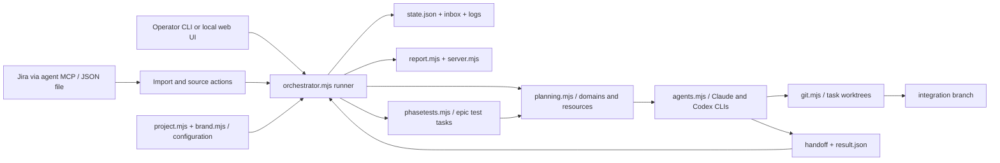
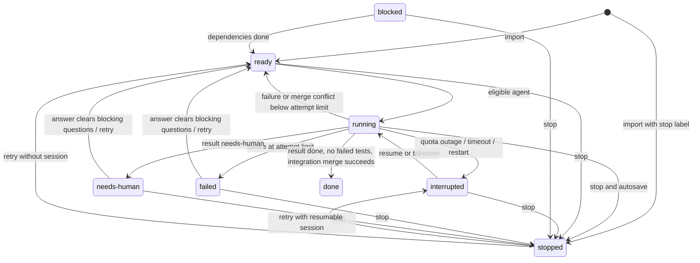
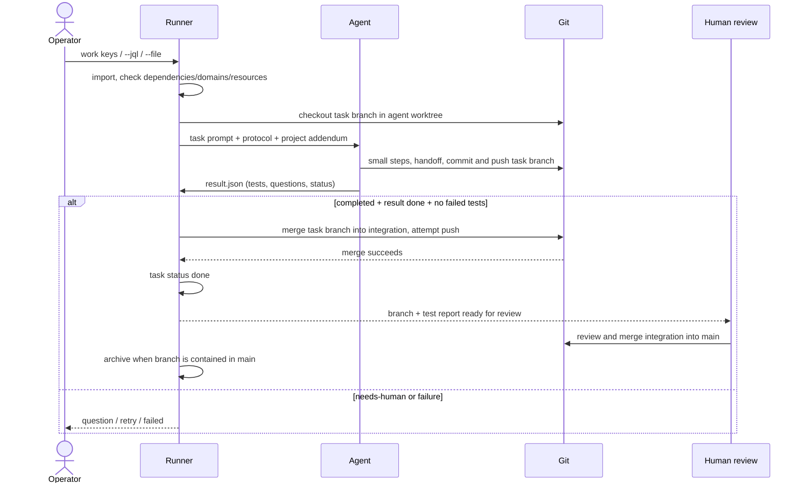

# ardai — Orchestrator für Claude + Codex

[English](README.md) · [Konfiguration und Migration](CONFIGURATION.md) · [Agentenprotokoll](AGENT_PROTOCOL.md)

## Zweck

ardai steuert Claude Code und Codex unbeaufsichtigt über ihre CLIs in getrennten Git-Worktrees.
Der Scheduler selbst nutzt keine KI und läuft weiter, wenn einem Agenten das Kontingent ausgeht.
Er importiert Jira-Tickets oder lokale JSON-Aufgaben, verhindert Überschneidungen deklarierter
Arbeitsbereiche und Ressourcen, sammelt Fragen und Tests und mergt fertige Aufgaben nach integration.
Das eigenständige Projekt ist [ardai](https://github.com/opxon-andre/ardai).

## Installation

Voraussetzungen: Node.js **24 oder neuer**, Git und authentisierte Claude-Code-/Codex-CLIs.
Für Jira benötigt der Agent Zugriff auf sein Atlassian-MCP; der Orchestrator hält keine Jira-Zugangsdaten.
Docker/Playwright sind nur für entsprechende Aufgaben nötig. Es gibt keine npm-Abhängigkeiten.

In der Wurzel des ardai-Repositories:

```sh
node orchestrator.mjs install-cli
```

Der Installer erstellt Shell- und .cmd-Launcher für die wirksame CLI und ihre konfigurierten Aliase im Benutzerverzeichnis .local/bin.
Dieses Verzeichnis zu PATH hinzufügen, falls der Installer es meldet. Ein optionales
Verzeichnisargument ändert das Installationsziel. Die Launcher referenzieren diesen Checkout;
er muss verfügbar bleiben. Alternativ aus dem Zielprojekt
`node /absoluter/pfad/orchestrator.mjs <Befehl>` aufrufen.

## Schnellstart

In einem Git-Projekt mit erstem Commit und konfiguriertem Remote beginnen.
Vor init eine `ardai.config.json` in der Projektwurzel mit eigenen Werten anlegen, etwa:

```json
{
  "schemaVersion": 2,
  "language": "de",
  "jiraBaseUrl": "https://example.atlassian.net",
  "source": { "type": "jira", "cloudId": "<eigene-cloud-id>" },
  "contextDocs": [{ "path": "docs/architecture.md", "note": "Hintergrund, kein Zusatzauftrag" }]
}
```

Echte Projektwerte und ein vorhandenes Kontextdokument verwenden. Ein Marker nur mit
`{"schemaVersion":2}` nutzt die Defaults; Jira benötigt Agentenzugriff und Projekteinstellungen.
`.orchestrator/` und `.orchestrator-run/` im Projekt ignorieren; Handoffs committen.
init nicht bloß zum Ausprobieren hier ausführen: Es installiert einen Hook, erstellt integration
und Agenten-Worktrees und versucht, den Integration-Branch zu pushen.

```sh
ardai init
ardai import TASK-123
ardai status
ardai patch TASK-123 --domain +src/component/ --domain -old/component/ --size S --note "Aktuelle Komponente verwenden"
ardai work TASK-123
ardai status
ardai run
```

`import` erlaubt die Prüfung des Auftrags vor dem Start. `work` importiert und startet einen
Hintergrund-Runner für diese Aufgaben; er wartet über Outages und Fragen hinweg, bis sie fertig
oder gestoppt sind. `run` verarbeitet den gesamten gespeicherten State im Vordergrund;
separat verwenden, wenn kein Runner aktiv ist. `run --exit-when-idle` endet ohne ausführbare Arbeit.
`run -v` / `work -v` zeigen Live-Aktivität.
`work --jql "project = TASK AND status = 'To Do'"` fragt passende Aufgaben regelmäßig neu ab.
`work --file tasks.json` akzeptiert lokale IDs ohne Jira-Key-Prüfung.

Beispiel für eine lokale Aufgabendatei (importiert wird ein Array):

```json
[
  {
    "id": "local-docs",
    "title": "Komponente dokumentieren",
    "domain": ["src/component/"],
    "description": "Einrichtung und Grenzen erklären.",
    "acceptanceCriteria": ["Einrichtungsbefehle sind dokumentiert"],
    "dependsOn": [],
    "size": "S"
  }
]
```

## Aufgaben im Betrieb korrigieren

`patch` unterstützt `--epic`, `--agent claude|codex`, `--size S|M|L`, `--note`
sowie wiederholbare `--domain +pfad/-pfad` und `--depends +ID/-ID`.
Abhängigkeiten müssen existieren; Zyklen und leere Domains werden abgelehnt.
Bei laufenden Aufgaben ist nur `--note` erlaubt. Vor Scope-Änderungen die Aufgabe stoppen.
Ein aktiver Runner besitzt den State; CLI-Änderungen laufen über `inbox.jsonl`.
Ohne Runner wirken sie direkt. Patch startet keinen Runner.

```sh
ardai stop TASK-123
ardai patch TASK-123 --epic TASK-100 --depends +TASK-122
ardai retry TASK-123
ardai run
ardai answer Q1 "Vorhandene API verwenden"
ardai hints --all
ardai ack Q2
```

retry/answer speichern ohne laufenden Runner standardmäßig nur Änderungen.
`--start` oder `autoStartRunner: true` starten einen Hintergrund-Runner für den **gesamten State**.
Ein laufender work-Runner nimmt wiederaufgenommene Aufgaben in seinen Umfang auf.
Antworten auf fertige/archivierte Aufgaben erzeugen Nachträge `<Ursprungs-ID>-N<n>`;
`answer Q1 "..." --domain +extra/pfad/` erweitert nur diesen Nachtrag.
Ursprungszähler und vorhandene Suffixe verhindern die erneute Vergabe alter Nummern.

## Architektur und Ablauf

Die Diagramme entsprechen [Runner](orchestrator.mjs), [Scheduler](lib/planning.mjs),
[Git-Operationen](lib/git.mjs) und [Phasentest-Planer](lib/phasetests.mjs).
Die Sequenz zeigt Auftrag, Agent, Integration und die anschließende menschliche Review vor main.







Die Task-Zustände heißen exakt `ready`, `running`, `interrupted`, `needs-human`,
`failed`, `stopped`, `blocked` und `done`. Der Mermaid-Alias `needs_human` zeigt den
Code-Wert `needs-human`. Offene Abhängigkeiten verhindern die Auswahl auch bei ready;
bestehende/importierte blocked-Aufgaben werden bei erfüllten Abhängigkeiten ready.
Im State fehlende Abhängigkeiten gelten als historisch/extern erledigt.

Es gibt keinen eigenen Review-Zustand und keine technische Review-Freigabe vor dem Integration-Merge.
Ein abgeschlossener Prozess mit Ergebnisstatus done ohne fehlgeschlagene Tests erlaubt den Merge.
Der Runner beweist nicht selbst, dass jedes Akzeptanzkriterium getestet wurde; das fordert das Protokoll.
Jira „In Review“ und interner Task-Status done sind verschiedene Begriffe.
Archivierung setzt `archivedAt`, keinen neuen Status. Automatisch wird archiviert, sobald der
Task-Branch in main enthalten ist. Manuelles archive/unarchive ist ebenfalls möglich.

### Kontingent-Übernahme bei Outage

Claude liefert strukturierte `rate_limit_event`-Daten; Codex-Kontingente stammen aus Session-Logs.
Textmuster sind ein Fallback. Die Vorabprüfung verwendet quotaThresholdPercent; kostenpflichtige
Nutzung ist nur bei expliziter Erlaubnis und verfügbarem Zusatzkontingent zulässig.
Bei Outage sperrt der Runner den Agenten bis zum Reset (sonst fallbackBackoffMinutes),
versucht Autosave-Commit und Push und gibt den Worktree frei. Die Aufgabe wird interrupted;
ein Kontingent-Outage verbraucht keinen Fehlversuch.
Ein anderer verfügbarer Agent kann übernehmen, soweit Domains, Ressourcen und Abhängigkeiten passen.
Derselbe Agent setzt seine gespeicherte Session nur fort, wenn ihm die unterbrochene Aufgabe noch
zugeordnet ist; eine Übernahme bekommt einen neuen Prompt und den Handoff.
Ein Reset holt keine bereits anderswo laufende Aufgabe zurück. Timeout/Neustart unterbrechen ebenfalls.
Beim Runner-Neustart werden eingetragene lebende Prozesse beendet und ihre Aufgaben als interrupted
wiederhergestellt. Autosave-/Push-Fehler werden protokolliert; bei Transportfehlern Remote-Stand prüfen.

### Phasentests

Sobald alle Implementierungsaufgaben eines Epics done sind, plant der Orchestrator
`<EPIC>-PHASENTEST` (später -2, -3 für neue, bisher nicht abgedeckte Aufgaben).
Dies sind lokale Aufgaben vom Typ phase-test mit Größe S, Ressource docker und Abhängigkeiten
auf die neu abgedeckten Implementierungsaufgaben. skipEpics schließt ausgewählte Epics aus.
Offene Phasentests verhindern doppelte Planung. Einzelaufgaben erledigen Code-Checks und direkte
Akzeptanztests; Phasentests bündeln Playwright-/Container-Tests und erhalten bereits grüne
check/ac-Ergebnisse als Liste „nicht wiederholen“.

Bei phaseTestLocalSecrets null wird nichts bereitgestellt. Ein konfiguriertes Verzeichnis muss
relativ, ohne Punkt-/Traversal-Segmente innerhalb des Repos und im Worktree per Git ignoriert sein.
Nur ein Phasentest-Prompt mit bereitgestellten Secrets gewährt diese Ausnahme. Nach dem Lauf wird
das Verzeichnis entfernt. phaseTestComposeProject isoliert Compose-Ressourcen vom lokalen Benutzerstack.

## Projektzusatz-Protokoll

[AGENT_PROTOCOL.md](AGENT_PROTOCOL.md) enthält die allgemeinen Regeln: Handoff zuerst lesen,
START/DONE/NOTE kleinteilig anhängen, jeden fertigen Schritt committen/pushen, Scope einhalten,
Ergebnisse protokollieren. Projektregeln gehören in `ardai.protocol.md` in der Projektwurzel.
Fehlt die Datei, werden die Namen in `brand.legacyNames.protocolFiles` der Reihe nach versucht.
Ein explizites `protocolAddendum` (etwa `docs/agent-protocol.md`) hat Vorrang;
fehlt diese Datei, wird kein Fallback geladen. Genau ein Zusatz wird angehängt, auch bei Resume.
Der Pfad muss innerhalb des Projekts liegen. Firmenspezifische Regeln gehören hierhin, außerhalb des Tools.

Agenten schreiben `.handoff/<TASK-ID>.md` und `.orchestrator-run/result.json` in ihren Worktree;
diese Pfade sind unabhängig von runtimeDir. Das Ergebnis enthält taskId, status
(done/needs-human/failed), summary, questions und tests; exaktes JSON siehe Protokoll.
Fragen enthalten question/context/assumption/blocking; Tests component/criterion/kind/result/note.
Jedes direkt geprüfte Kriterium muss aufgeführt werden. Die Ergebnisdatei wird nicht committet.

## Konfigurationsreferenz

Die Projektsuche prüft aufwärts zuerst `ardai.config.json`, dann die Tool-Namen
`brand.configFile` und `brand.legacyNames.configFiles`.
Der nächste Marker definiert die Projektwurzel. Priorität: mitgelieferte [config.json](config.json),
Projektmarker, dann die Datei aus `ORCHESTRATOR_CONFIG`.
Objekte werden rekursiv zusammengeführt; Arrays/Skalare ersetzen vollständig, auch false, [] und null.
Ein relativer ORCHESTRATOR_CONFIG-Dateiname bezieht sich auf das Aufrufverzeichnis; enthaltene Pfade
beziehen sich weiterhin auf die Projektwurzel. Die Variable ersetzt keinen Projektmarker.

Alle Felder der mitgelieferten Default-Config einschließlich Objektcontainer folgen.
Werte sind JSON; die CLI-Argumentlisten sind die exakten Defaults.

| Feld | Default (JSON) | Bedeutung |
| --- | --- | --- |
| `schemaVersion` | `2` | Config-Schema; Version 1 oder fehlende Version wird im Speicher auf 2 migriert; neuere Versionen werden abgelehnt. |
| `resultsDir` | `".orchestrator/results"` | HTML-Testberichte mit Zeitstempel; relativ zur Projektwurzel. |
| `keyPattern` | `"[A-Z][A-Z0-9]+-\\d+"` | Regex-Quelltext zur vollständigen Ticket-Key-Prüfung; lokale Datei-IDs umgehen diese Prüfung. |
| `exampleDomains` | `["src/component/"]` | Neutrale Pfadbeispiele im Import-Prompt; [] entfernt sie. |
| `hooks` | Objekt (siehe Unterfelder) | Git-Hook-Einstellungen. |
| `hooks.prePush` | `null` | Eigener projektrelativer Hook oder null für den mitgelieferten Hook; init kopiert ihn. |
| `jiraBaseUrl` | `""` | Jira-Basis-URL für Ticketlinks; pro Projekt setzen. |
| `language` | `"de"` | Sprache für Konsole, Berichte und UI: de oder en. |
| `ui` | Objekt (siehe Unterfelder) | Einstellungen der lokalen Weboberfläche. |
| `ui.enabled` | `true` | UI automatisch mit run/work starten. |
| `ui.port` | `4711` | Lokaler HTTP-Port. |
| `source` | Objekt (siehe Unterfelder) | Ticketquelle; Jira ist die unterstützte externe Quelle. |
| `source.type` | `"jira"` | Externer Quelladapter: jira. |
| `source.cloudId` | `""` | Atlassian-Cloud-ID für Agenten-MCP-Prompts; pro Projekt setzen. |
| `source.todoStatus` | `"To Do"` | Jira-Zielstatus für clean. |
| `worktreeRoot` | `"../ardai-worktrees"` | Übergeordnetes Worktree-Verzeichnis, ab Projektwurzel aufgelöst. |
| `integrationBranch` | `"integration"` | Automatisches Merge-Ziel; für sicheren Betrieb von main getrennt halten. |
| `baseBranch` | `"main"` | Ausgangsbranch zum Anlegen von integration. |
| `remote` | `"origin"` | Git-Remote für Fetch/Push. |
| `tickSeconds` | `30` | Scheduler-Intervall in Sekunden. |
| `autoStartRunner` | `false` | retry/answer dürfen einen Hintergrundlauf für den gesamten State starten; --start erlaubt es pro Aufruf. |
| `maxRunMinutes` | `120` | Agenten-Laufzeitlimit in Minuten; Timeout unterbricht die Aufgabe. |
| `maxAttempts` | `3` | Fehlversuchsgrenze vor failed und blockierender Frage; Kontingent-Outages zählen nicht. |
| `fallbackBackoffMinutes` | `30` | Agentensperre in Minuten, wenn der Reset-Zeitpunkt unbekannt ist. |
| `quotaThresholdPercent` | `97` | Vorab-Sperrgrenze für Kontingentauslastung in Prozent. |
| `reimportMinutes` | `30` | Jira-Import-Cache und Aktualisierungsintervall für work --jql in Minuten; --reimport erzwingt Import. |
| `phaseTests` | Objekt (siehe Unterfelder) | Gebündelte Epic-Testplanung. |
| `phaseTests.skipEpics` | `[]` | Von automatischen Phasentests ausgeschlossene Epic-IDs. |
| `phaseTestLocalSecrets` | `null` | Null deaktiviert Bereitstellung; sonst ignoriertes repo-relatives Verzeichnis, nur für Phasentests kopiert und danach entfernt. |
| `phaseTestComposeProject` | `"ardai-phasetest"` | Eigener Docker-Compose-Projektname im Phasentest-Auftrag. |
| `contextDocs` | `[]` | Liste von {path, note?} für Projektkontext im Aufgaben-Prompt. |
| `codeGraph` | `{}` | Optionale code-review-graph-Anbindung; leer deaktiviert. |
| `agents` | Objekt (siehe Unterfelder) | Benannte Agenten-Konfigurationsobjekte. |
| `agents.claude` | Objekt (siehe Unterfelder) | Konfiguration dieses Agenten. |
| `agents.claude.kind` | `"claude"` | CLI-Adapter (claude oder codex). |
| `agents.claude.enabled` | `true` | Für Scheduler und Import-Empfehlungen aktiviert. |
| `agents.claude.command` | `"claude"` | CLI-Programm; Umgebungsplatzhalter werden expandiert. Codex bevorzugt unter Windows gegebenenfalls das Desktop-App-Programm. |
| `agents.claude.args` | `["-p","--output-format","stream-json","--verbose","--dangerously-skip-permissions","--disallowedTools","mcp__atlassian"]` | Basis-CLI-Argumente, unverändert übergeben; Flags zur Umgehung von Berechtigungsabfragen vor Nutzung prüfen. |
| `agents.claude.preferredDomains` | `[]` | Bevorzugte Pfadpräfixe; Scheduler-Präferenz, keine Zugriffsgrenze. |
| `agents.claude.bySize` | Objekt (siehe Unterfelder) | Überschreibungen nach Aufgabengröße (S/M/L); passende args ergänzen die Basisargumente. |
| `agents.claude.bySize.S` | Objekt (siehe Unterfelder) | Überschreibung für kleine Aufgaben. |
| `agents.claude.bySize.S.label` | `"Sonnet"` | Angezeigter Modell-/Reasoning-Name. |
| `agents.claude.bySize.S.args` | `["--model","sonnet"]` | Zusätzliche CLI-Argumente dieser Größe. |
| `agents.claude.allowOverage` | `false` | Anfangswert für kostenpflichtige Nutzung; State/overage-Befehl hat Vorrang. |
| `agents.codex` | Objekt (siehe Unterfelder) | Konfiguration dieses Agenten. |
| `agents.codex.kind` | `"codex"` | CLI-Adapter (claude oder codex). |
| `agents.codex.enabled` | `true` | Für Scheduler und Import-Empfehlungen aktiviert. |
| `agents.codex.command` | `"codex"` | CLI-Programm; Umgebungsplatzhalter werden expandiert. Codex bevorzugt unter Windows gegebenenfalls das Desktop-App-Programm. |
| `agents.codex.fallbackCommand` | `"codex"` | Programm-Fallback, wenn Desktop-Codex nicht gefunden wird. |
| `agents.codex.args` | `["exec","--json","--dangerously-bypass-approvals-and-sandbox","-c","model=\"gpt-6.1-sol\"","-c","model_reasoning_effort=\"medium\""]` | Basis-CLI-Argumente, unverändert übergeben; Flags zur Umgehung von Berechtigungsabfragen vor Nutzung prüfen. |
| `agents.codex.sessionsDir` | `"%USERPROFILE%\\.codex\\sessions"` | Codex-Session-Logs zur Kontingentprüfung; %VARIABLE%-Expansion unterstützt. |
| `agents.codex.preferredDomains` | `[]` | Bevorzugte Pfadpräfixe; Scheduler-Präferenz, keine Zugriffsgrenze. |
| `agents.codex.bySize` | Objekt (siehe Unterfelder) | Überschreibungen nach Aufgabengröße (S/M/L); passende args ergänzen die Basisargumente. |
| `agents.codex.bySize.S` | Objekt (siehe Unterfelder) | Überschreibung für kleine Aufgaben. |
| `agents.codex.bySize.S.label` | `"Reasoning low"` | Angezeigter Modell-/Reasoning-Name. |
| `agents.codex.bySize.S.args` | `["-c","model_reasoning_effort=\"low\""]` | Zusätzliche CLI-Argumente dieser Größe. |

### Weitere unterstützte Felder

Optionale Laufzeit-/Loader-Einstellungen außerhalb der rohen Default-Config:

| Feld | Effektiver Default | Bedeutung |
| --- | --- | --- |
| `runtimeDir` | `".orchestrator"` | Zentraler State, Logs, Lock, Inbox und Live-Bericht; überschreibt brand.runtimeDir. |
| `protocolAddendum` | `"ardai.protocol.md"` | Ohne expliziten Wert: Branding-Datei, dann legacyNames.protocolFiles; ein expliziter fehlender Pfad lädt keinen Zusatz. |
| `source.stoppedLabel` | `"ardai:stopped"` | Stopp-Label; zusätzlich werden brand.legacyNames.stoppedLabels erkannt und bei Resume/Clean entfernt. |
| `codeGraph.python` | `unset` | Python-Programm mit installiertem code_review_graph; %VARIABLE% möglich. Build/Update je Worktree, MCP mit auto-watch. |
| `contextDocs[].path` | `unset` | Projektrelative Dokumentreferenz; Agent erhält Leseauftrag. |
| `contextDocs[].note` | `unset` | Optionaler Kontexthinweis, etwa zu ignorierende überholte Abschnitte. |
| `agents.codex.allowOverage` | `false (effective)` | Fehlt im JSON; Boolean-Konvertierung ergibt effektiv false, wie bei anderen Agenten. |
| `agents.<name>.bySize.M` | `unset` | Optionale M-Überschreibung mit label und args; sonst Basisargumente. |
| `agents.<name>.bySize.L` | `unset` | Optionale L-Überschreibung mit label und args; sonst Basisargumente. |

## Branding

Die mitgelieferte [brand.json](brand.json) liefert diese Defaults.
Ein `brand`-Objekt in der Projekt-Config überschreibt einzelne Felder.

| Feld | Default (JSON) | Bedeutung |
| --- | --- | --- |
| `brand.name` | `"ardai"` | Anzeigename. |
| `brand.cli` | `"ardai"` | Primärer Launcher-Befehl. |
| `brand.aliases` | `[]` | Zusätzliche Launcher-Namen. |
| `brand.configFile` | `"ardai.config.json"` | Primärer Projektmarker-Dateiname. |
| `brand.protocolAddendum` | `"ardai.protocol.md"` | Erster Zusatzdateiname ohne explizite Überschreibung. |
| `brand.runtimeDir` | `".orchestrator"` | Default des zentralen Laufzeitordners. |
| `brand.stoppedLabel` | `"ardai:stopped"` | Default-Label für gestoppte Tickets. |
| `brand.processName` | `"ardai"` | Prozesstitel im Betriebssystem. |
| `brand.legacyNames` | object (siehe Unterfelder) | Optionale Namen für bestehende Projekte. |
| `brand.legacyNames.configFiles` | `[]` | Alte Config-Dateinamen für die Projektsuche; vor der Suche auf Tool-Ebene konfigurieren. |
| `brand.legacyNames.protocolFiles` | `[]` | Alte Protokoll-Dateinamen, der Reihe nach geprüft. |
| `brand.legacyNames.stoppedLabels` | `[]` | Alte Stopp-Labels für Import, Resume und Clean. |
| `brand.legacyNames.agentIds` | `[]` | Alte interne Absender-IDs in State-Dateien. |

ARDAI_BRAND_FILE benennt eine JSON-Datei im Format von brand.json, die vor der Projektsuche die eingebauten Marken-Defaults überschreibt. Relative Pfade beziehen sich auf das Aufrufverzeichnis. Projekt-brand und anschließend ORCHESTRATOR_CONFIG haben Vorrang. Ohne Projekt gelten die Tool-Werte auch für Hilfe und install-cli. Arrays ersetzen vorhandene Listen.

Beispiel für diese Tool-Datei:

```json
{"aliases":["demo-alias"],"legacyNames":{"configFiles":["old.config.json"],"protocolFiles":["old.protocol.md"],"stoppedLabels":["old:stopped"],"agentIds":["old-runner"]}}
```

Nach Änderungen an CLI-Namen install-cli erneut ausführen. Explizite runtimeDir und source.stoppedLabel haben Vorrang. Die konfigurierten alten Labels werden beim Import erkannt und bei Resume/Clean entfernt. Die interne Absenderkennung bleibt orchestrator; brand.legacyNames.agentIds erkennt alte interne IDs.

Projektrelative runtimeDir/resultsDir/worktreeRoot/eigene Hook-Pfade dürfen auch absolut sein.
Nur mitgelieferte Ressourcen beziehen sich auf das Tool-Verzeichnis.
Im Laufzeitordner liegen state.json, logs/, run.lock, inbox.jsonl, runner.log, report.html,
hints.md, Importe und source-actions/. Config und State verwenden schemaVersion 2;
Version 1/fehlende Version bleibt lesbar. Lesen schreibt keine Dateien um.
Die erste State-Migration erzeugt eine bytegenaue state.json.bak; spätere Schreibvorgänge sind atomar.
Nur bei gestopptem Runner wiederherstellen. Ungültige/neuere Versionen werden abgelehnt.
Details zu Migration/Pfaden stehen in [CONFIGURATION.md](CONFIGURATION.md).

## Betrieb und Berichte

`status` zeigt Aufgaben, Kontingente und Fragen. `log [TASK|AGENT] -f [-n N]` verfolgt Aktivität.
`report` schreibt einen HTML-Bericht mit Zeitstempel nach resultsDir; die Live-Ansicht liegt in
runtimeDir/report.html. `serve [--no-open]` startet die lokale UI; run/work starten sie bei Aktivierung
automatisch. Das Terminal zeigt die URL mit Token. Diese URL und Logs vertraulich behandeln.

`stop <ID>` beendet den Prozessbaum, versucht Autosave/Push und lässt stopped bis retry bestehen;
`stop` beendet alle Agenten und den Runner. `clean <ID>` löscht lokale/Remote-Task-Branches,
Fragen und Testergebnisse und merkt Jira To Do vor; integrierte Aufgaben sind davon ausgeschlossen.
`archive`/`unarchive` verbergen/zeigen Einträge. `overage codex on|off` (auch claude) schaltet
kostenpflichtige Nutzung im State. `sync` wiederholt vorgemerkte Quellupdates; nach drei Fehlern
werden sie zu Fragen. Ticketupdates nutzen kurze Agenten-MCP-Aufrufe; fehlende Agenten verzögern sie.

## Sicherheitsregeln

- Agentenarbeit niemals nach main pushen. init installiert einen pre-push-Hook gegen Main-Pushes
  aus konfigurierten Worktree-Pfaden, verknüpften Worktrees und ORCHESTRATOR_AGENT-Prozessen.
  Menschliche Pushes aus dem Hauptprojekt bleiben möglich. Nach worktreeRoot-Änderungen init
  wiederholen; zusätzlich serverseitigen Branch-Schutz aktivieren. Ein vorhandener fremder Hook
  erfordert manuelle Zusammenführung; eigene Hooks werden unverändert kopiert.
- Während der Implementierung keine Secrets, Zugangsdaten oder Dateien außerhalb des Repos lesen/schreiben.
  Nur explizit bereitgestellte lokale Phasentest-Secrets sind ausgenommen. Keine Zugangsdaten in
  Konfiguration, Prompts, Logs, Handoffs oder Commits aufnehmen.
- Agenten laufen standardmäßig mit Flags zur Umgehung von Berechtigungsabfragen/Sandbox.
  Domain- und Secret-Grenzen sind Protokollregeln, keine Betriebssystem-Sandbox.
  Nur vertrauenswürdige Projekte, Konfigurationen, Aufgaben und Zusätze verwenden;
  ausführbare Programme und Argumentlisten prüfen.
- Der Webserver bindet 127.0.0.1, prüft Host und verlangt bei jeder Anfrage ein zufälliges Token pro Start.
  Lokal halten und die Token-URL nicht veröffentlichen.

## Grenzen

Windows ist die primäre Laufzeit: Prozessbaum-Abbruch verwendet taskkill, Desktop-Codex-Suche nutzt
Windows-Pfade. Shell-Launcher belegen keine vollständige POSIX-Unterstützung.
Der Datei-Importer übernimmt ein angegebenes jira:false derzeit nicht; Quellaktionen für lokale
Importaufgaben können deshalb trotzdem Jira-Updates versuchen. Diese Grenze bei Dateiaufgaben beachten.
Der externe Ticketadapter unterstützt Jira; GitHub Issues ist geplant. Import und Ticketupdates
benötigen einen Agenten mit MCP-Zugriff, Kontingent und Netzverbindung.
Handoffs und gepushte Commits bilden die Wiederaufnahmebasis; fehlgeschlagene Pushes garantieren
keine Remote-Wiederherstellung.

Der Scheduler verhindert deklarierte Pfad-/Ressourcenkonflikte; ungenannte Abhängigkeiten,
gemeinsame externe Dienste und falscher Scope brauchen weiterhin menschliche Beurteilung.
Auto-Merge vertraut Ergebnisangaben; menschliche Review vor main bleibt nötig.
Der Git-Wrapper wertet fehlgeschlagene Integration-Pushes derzeit nicht als Merge-Fehler;
bei Netzfehlern Remote-Stand prüfen. Echte Kontingent-Fehlertexte können je CLI-Version abweichen;
Fallback-Muster beim ersten echten Outage gegen Logs prüfen.

## Tests

```sh
node --test test
npm test
```

Alternativ npm test im Tool-Verzeichnis ausführen. Die Suite benötigt Node 24+ und Git und verwendet
isolierte lokale Fixtures ohne Netz, Jira, echte Agenten oder laufenden Stack.
Der Dokumentationstest prüft jedes Default-Feld samt Blattwert in beiden READMEs und die Diagramm-/Zustandsregeln.

## Status / Contributing

Das Projekt steht am Anfang; Beitragsregeln folgen.

## Lizenz

MIT-Lizenz, Copyright (c) 2026 opXon GmbH, Andre Joswig. Siehe [LICENSE](LICENSE). Der Copyright-Hinweis und der Lizenzhinweis müssen in allen Kopien oder wesentlichen Teilen der Software erhalten bleiben.

## Name

Der offizielle Name ist **ardai**. Jede*r kann sich über `brand.aliases` in der Projektkonfiguration einen eigenen Rufnamen für den Befehl setzen (und mit `brand.legacyNames` alte Datei- oder Label-Namen behalten).
