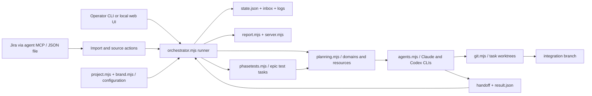
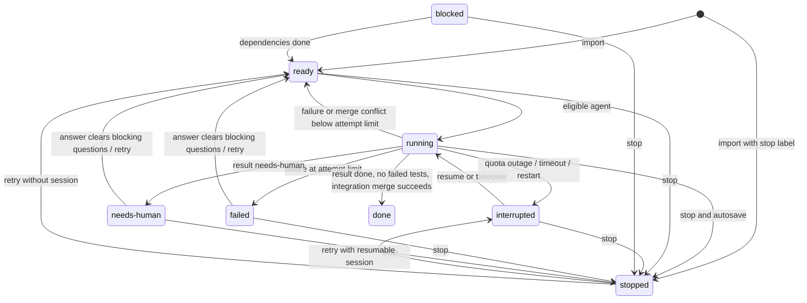
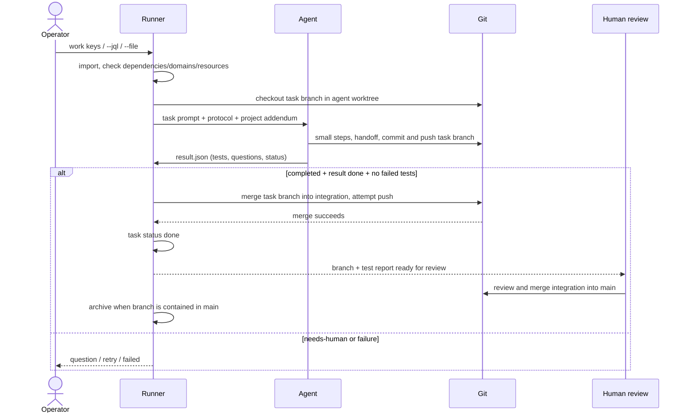

# ardai — Claude + Codex orchestration

[Deutsch](README.de.md) · [Configuration and migration details](CONFIGURATION.md) · [Agent protocol](AGENT_PROTOCOL.md)

## Purpose

ardai coordinates unattended Claude Code and Codex CLI work in separate Git worktrees.
The scheduler itself uses no AI, so it can keep scheduling when an agent exhausts its quota.
It imports Jira tickets or local JSON tasks, avoids overlapping domains and shared resources,
tracks questions and test results, and merges completed task branches into an integration branch.
The standalone project is [ardai](https://github.com/opxon-andre/ardai).

## Installation

Run directly with Node/npm as described below, or use the container with bind mounts,
file-based secrets and access to the host Docker daemon. See the [container guide](CONTAINER.md)
for setup. Both modes default to `127.0.0.1:4711`; environment variables can override it.

Use Node.js **24 or newer**, Git, and authenticated Claude Code and/or Codex CLIs.
Windows and Linux are supported. On Linux, install the native CLIs and Git in the
same environment as Node (also when using WSL).
For Jira work, configure the agent's Atlassian MCP access; the orchestrator holds no Jira credentials.
Docker/Playwright are needed only for tasks that require them. No npm dependencies are required.

From the ardai repository root:

```sh
node orchestrator.mjs install-cli
```

This installs executable shell launchers for the effective CLI and its configured aliases into the user's `.local/bin`.
On Windows, `.cmd` launchers are installed as well.
Add that directory to PATH if the installer reports it missing. An optional directory argument changes
the install location. Launchers reference this checkout: keep it available. Alternatively invoke
`node /absolute/path/to/orchestrator.mjs <command>` from the target project.

On Linux, add the directory to your shell profile if needed:

```sh
export PATH="$HOME/.local/bin:$PATH"
ardai --help
```

The UI opens through `xdg-open` on Linux desktops (package `xdg-utils`). On a
headless server, use `ardai serve --no-open` and the printed URL. For a remote
server, forward the local UI port with `ssh -L 4711:127.0.0.1:4711 user@server`
and open the printed token URL locally. The server remains bound to loopback.
Stopping tasks and timeouts terminate the agent's POSIX process group, including
ordinary shell/test children. Programs that deliberately detach into another session
and Docker containers need their own cleanup. `SIGTERM` releases the runner lock,
just like Ctrl+C; use `ardai stop` to also stop the agents and save their work.

## Quickstart

Start in a Git project with an initial commit and a configured remote.
Before init, create `ardai.config.json` at its root with project overrides, for example:

```json
{
  "schemaVersion": 2,
  "language": "en",
  "jiraBaseUrl": "https://example.atlassian.net",
  "source": { "type": "jira", "cloudId": "<your-cloud-id>" },
  "contextDocs": [{ "path": "docs/architecture.md", "note": "Background, not additional scope" }]
}
```

Use real project values and an existing context document. A marker containing only
`{"schemaVersion":2}` uses tool defaults; Jira requires working agent access and project settings.
Ignore `.orchestrator/` and `.orchestrator-run/` in the project; commit handoffs.
Do not run init here just to try the command: it installs a hook, creates integration and agent
worktrees, and attempts to push the integration branch.

```sh
ardai init
ardai import TASK-123
ardai status
ardai patch TASK-123 --domain +src/component/ --domain -old/component/ --size S --note "Use the current component"
ardai work TASK-123
ardai status
ardai run
```

`import` lets you inspect scope before execution. `work` imports and starts a background runner
for the requested tasks, then waits through outages/questions until they are done or stopped.
`run` processes the entire saved state in the foreground; use it separately when no runner is active.
`run --exit-when-idle` exits when there is no runnable work; `run -v` / `work -v` show live activity.
`work --jql "project = TASK AND status = 'To Do'"` refreshes matching work periodically.
`work --file tasks.json` accepts local task IDs without Jira-key validation.

Local task file example (the imported file is an array):

```json
[
  {
    "id": "local-docs",
    "title": "Document the component",
    "domain": ["src/component/"],
    "description": "Explain setup and limits.",
    "acceptanceCriteria": ["Setup commands are documented"],
    "dependsOn": [],
    "size": "S"
  }
]
```

### Correct tasks while running

`patch` supports `--epic`, `--agent claude|codex`, `--size S|M|L`, `--note`,
and repeatable `--domain +path/-path` and `--depends +ID/-ID`.
Dependencies must exist; cycles and an empty domain are rejected.
While a task is running, only `--note` is accepted. Stop it before changing its scope.
An active runner owns state; CLI mutations go through `inbox.jsonl`.
Without a runner they apply directly. Patch does not start a runner.

```sh
ardai stop TASK-123
ardai patch TASK-123 --epic TASK-100 --depends +TASK-122
ardai retry TASK-123
ardai run
ardai answer Q1 "Use the existing API"
ardai hints --all
ardai ack Q2
```

By default retry/answer only save changes when no runner exists. `--start` or
`autoStartRunner: true` starts a background runner for the **whole state**.
A running work runner includes resumed tasks in its scope.
Answers to completed/archived tasks create follow-ups `<root-ID>-N<n>`;
`answer Q1 "..." --domain +extra/path/` adds scope only to that follow-up.
The root counter and existing suffixes prevent reuse of follow-up numbers.

## Architecture and workflow

The diagrams reflect [runner](orchestrator.mjs), [scheduler](lib/planning.mjs),
[Git operations](lib/git.mjs), and [phase planner](lib/phasetests.mjs).







Task states are exactly `ready`, `running`, `interrupted`, `needs-human`, `failed`,
`stopped`, `blocked`, and `done`. Mermaid's `needs_human` alias displays the code value
`needs-human`. Unmet dependencies prevent scheduling even if a task remains ready;
legacy/imported blocked tasks become ready once dependencies finish.
A dependency absent from state is treated as historical/externally completed.

There is no separate review state or automated review approval gate. A completed process plus
result status done with no failed test entries allows the integration merge. The runner does
not prove that every acceptance criterion has a test: the agent protocol requires it.
Jira "In Review" and the internal task state done are different concepts.
Archival sets `archivedAt`, not a new task status; tasks are automatically archived after
their branch is contained in main. Manual archive/unarchive is also available. Task lists show the most recently added tasks first. In the web UI, select completed, stopped or failed tasks with the checkboxes and use **Archive selected**; the header checkbox selects all eligible tasks. The CLI also accepts multiple IDs: `ardai archive TASK-1 TASK-2`.

### Quota outages and takeover

Claude supplies structured `rate_limit_event` data; Codex quota data comes from session logs.
Text patterns are a fallback. Preflight uses quotaThresholdPercent; paid usage is allowed only
when explicitly enabled and available. On outage the runner blocks that agent until reset
(or fallbackBackoffMinutes), attempts autosave commit/push and releases the worktree.
The task becomes interrupted; quota outages do not consume a failed attempt.
A different available agent can take over if domains, resources and dependencies permit.
The same agent resumes its saved session only when the interrupted task still belongs to it;
a takeover gets a fresh prompt and the handoff. Reset does not reclaim a task already running elsewhere.
Timeout/restart also interrupt work. On runner restart, recorded live processes are terminated
and their tasks recovered as interrupted. Autosave/push errors are logged: verify remote state
when recovering from transport failures.

### Phase tests

When every implementation task of an epic is done, the planner creates
`<EPIC>-PHASENTEST` (then -2, -3 for newly added, uncovered tasks).
These are local type phase-test tasks with size S, resource docker and dependencies on the
newly covered implementation tasks. skipEpics excludes selected epics.
Pending phase tests prevent duplicate planning. Individual tasks run code checks and direct
acceptance tests; phase tests bundle Playwright/container checks and receive previous passing
check/ac results as a do-not-repeat list.

With phaseTestLocalSecrets null, nothing is provisioned. A configured directory must be relative,
stay inside the repo without dot/traversal segments and be ignored in the worktree.
Only a phase-test prompt with provisioned secrets grants this exception. The directory is removed
after the run. Use phaseTestComposeProject to isolate Compose resources from the operator's stack.

## Project addendum protocol

[AGENT_PROTOCOL.md](AGENT_PROTOCOL.md) provides general rules: read handoff first, append START/DONE/NOTE
events in small steps, commit and push each completed step, stay in scope and record results.
Project-specific rules go into `ardai.protocol.md` at the project root.
If absent, files in `brand.legacyNames.protocolFiles` are tried in order.
An explicit `protocolAddendum` (e.g. `docs/agent-protocol.md`) takes precedence;
if its file is missing, no fallback is loaded. Only one addendum is appended, including on resume.
Its path must remain within the project. Keep company-specific policies here, outside the generic tool.

Agents write `.handoff/<TASK-ID>.md` and `.orchestrator-run/result.json` in their worktree;
these paths are independent of runtimeDir. Result fields are taskId, status
(done/needs-human/failed), summary, questions and tests; see the protocol for the exact JSON.
Questions contain question/context/assumption/blocking; tests contain
component/criterion/kind/result/note. Every directly checked criterion must be recorded.
The result file is not committed.

## Configuration reference

Project discovery searches upward for the nearest marker: `ardai.config.json` first,
then the tool-level `brand.configFile` and `brand.legacyNames.configFiles`.
The nearest marker defines the project root. Precedence is bundled [config.json](config.json),
then project marker, then the file named by `ORCHESTRATOR_CONFIG`.
Objects deep-merge; arrays/scalars replace completely, including false, [] and null.
A relative ORCHESTRATOR_CONFIG filename resolves from the calling directory; paths inside it
still resolve from the project root. It does not replace the project marker.

All fields of the shipped default config, including object containers, follow.
Values are JSON; CLI argument arrays are exact defaults.

| Field | Default (JSON) | Meaning |
| --- | --- | --- |
| `schemaVersion` | `2` | Configuration schema; version 1 or omitted is migrated in memory to 2; newer versions are rejected. |
| `resultsDir` | `".orchestrator/results"` | Timestamped HTML test snapshots; relative to the project root. |
| `keyPattern` | `"[A-Z][A-Z0-9]+-\\d+"` | Regex source for full ticket-key validation; local file IDs bypass Jira-key validation. |
| `exampleDomains` | `["src/component/"]` | Neutral path examples in import prompts; [] removes examples. |
| `hooks` | object (see child fields) | Git hook settings. |
| `hooks.prePush` | `null` | Custom project-relative hook or null for bundled hook; copied by init. |
| `jiraBaseUrl` | `""` | Jira base URL for ticket links; set per project. |
| `language` | `"de"` | Console/report/UI language: de or en. |
| `ui` | object (see child fields) | Local web UI settings. |
| `ui.enabled` | `true` | Automatically start UI with run/work. |
| `ui.port` | `4711` | Local HTTP port. |
| `source` | object (see child fields) | Ticket source settings; Jira is the supported external source. |
| `source.type` | `"jira"` | External source adapter: jira. |
| `source.cloudId` | `""` | Atlassian cloud ID supplied to agent MCP prompts; set per project. |
| `source.maxConcurrency` | `4` | Simultaneous REST ticket actions (1–32); actions within one ticket remain ordered. MCP fallback remains sequential. |
| `source.requestTimeoutSeconds` | `45` | Deadline for each HTTP request including its response body (1–300 seconds). |
| `source.todoStatus` | `"To Do"` | Jira status used by clean. |
| `worktreeRoot` | `"../ardai-worktrees"` | Worktree parent directory, resolved from project root. |
| `integrationBranch` | `"integration"` | Automatic merge target; must differ from main for safe operation. |
| `baseBranch` | `"main"` | Initial branch for creating integration. |
| `remote` | `"origin"` | Git remote for fetch/push. |
| `tickSeconds` | `30` | Scheduler polling interval in seconds. |
| `checkpointMinutes` | `10` | Minutes between automatic snapshots of running tasks under `refs/ardai/wip/<task>` (temporary index, agent branch untouched); 0 disables. |
| `ollama` | object (see child fields) | Optional local model that rewrites the review comment; enabled by default, without a reachable Ollama the template text is used. |
| `ollama.enabled` | `true` | Use Ollama for review-comment drafts; any failure falls back to the template text. |
| `ollama.url` | `"http://localhost:11434"` | Ollama server address. |
| `ollama.model` | `"qwen2.5:1.5b"` | Model name; small models suit CPU-only machines. |
| `ollama.timeoutSeconds` | `60` | Timeout per request; on expiry the template text is used. |
| `autoStartRunner` | `false` | Allow retry/answer to start a background run for the entire state; --start overrides per call. |
| `maxRunMinutes` | `120` | Agent run timeout in minutes; timeout interrupts task. |
| `maxAttempts` | `2` | Hard limit of failures per task before failed and a blocking question; quota outages do not count. Answers and a plain retry do not reset it, only `retry --force` by a human. The same failure on an unchanged branch content fails at once. |
| `budget` | object (see child fields) | Token budget per task: an estimate from the moving average of recent finished tasks of the same size, a hard limit, and a review before any extension. |
| `budget.enabled` | `true` | Turns the token budget off with false. |
| `budget.window` | `8` | Number of the most recent finished tasks of the same size used for the average. |
| `budget.minSamples` | `3` | Minimum finished tasks of that size; below it the task runs without a limit while the average calibrates. |
| `budget.hardFactor` | `1.5` | Hard limit as a multiple of the estimate; reaching it stops the agent and starts the review. |
| `budget.graceFactor` | `1.6` | Outermost limit as a multiple of the estimate, allowed only after a review found a clear completion signal; without one, a human decides. |
| `budget.reviewerModel` | `"sonnet"` | Claude model of the short review run at the hard limit. |
| `fallbackBackoffMinutes` | `30` | Minutes to block an exhausted agent when no reset time is known. |
| `quotaThresholdPercent` | `97` | Preflight quota-utilization threshold in percent. |
| `reimportMinutes` | `30` | Jira import cache and work --jql refresh interval in minutes; --reimport forces refresh. |
| `phaseTests` | object (see child fields) | Bundled epic test planning. |
| `phaseTests.skipEpics` | `[]` | Epic IDs excluded from automatic phase-test planning. |
| `phaseTestLocalSecrets` | `null` | Null disables provisioning; otherwise an ignored repo-relative directory, copied only for phase tests and removed afterwards. |
| `phaseTestComposeProject` | `"ardai-phasetest"` | Separate Docker Compose project name passed in phase-test instructions. |
| `contextDocs` | `[]` | Array of {path, note?} project-context references included in task prompts. |
| `codeGraph` | `{}` | Optional code-review-graph integration; empty disables it. |
| `agents` | object (see child fields) | Named agent configuration objects. |
| `agents.claude` | object (see child fields) | Configuration for this agent. |
| `agents.claude.kind` | `"claude"` | CLI adapter (claude or codex). |
| `agents.claude.enabled` | `true` | Eligible for scheduling/import recommendations. |
| `agents.claude.command` | `"claude"` | CLI executable; environment placeholders are expanded. Codex may prefer the desktop app executable on Windows. |
| `agents.claude.args` | `["-p","--output-format","stream-json","--verbose","--dangerously-skip-permissions","--disallowedTools","mcp__atlassian","--disable-slash-commands","--exclude-dynamic-system-prompt-sections","--tools","Bash,Read,Edit,Write,Grep,Glob,ToolSearch"]` | Base CLI argument array, passed verbatim; inspect permission-bypass flags before use. |
| `agents.claude.env` | `{"ENABLE_TOOL_SEARCH":"true"}` | Extra environment variables for the agent process. |
| `agents.claude.env.ENABLE_TOOL_SEARCH` | `"true"` | Extra environment variables for the agent process. `ENABLE_TOOL_SEARCH=true` loads MCP tool definitions on demand (via ToolSearch) instead of putting all of them into every turn. |
| `agents.claude.preferredDomains` | `[]` | Preferred path prefixes; scheduling preference, not an access boundary. |
| `agents.claude.bySize` | object (see child fields) | Task-size overrides (S/M/L); matching args are appended to base args. |
| `agents.claude.bySize.S` | object (see child fields) | Override for small tasks. |
| `agents.claude.bySize.S.label` | `"Sonnet"` | Displayed model/reasoning name. |
| `agents.claude.bySize.S.args` | `["--model","sonnet"]` | Additional CLI arguments for this size. |
| `agents.claude.allowOverage` | `false` | Initial paid-usage permission; runtime state/overage command takes precedence. |
| `agents.codex` | object (see child fields) | Configuration for this agent. |
| `agents.codex.kind` | `"codex"` | CLI adapter (claude or codex). |
| `agents.codex.enabled` | `true` | Eligible for scheduling/import recommendations. |
| `agents.codex.command` | `"codex"` | CLI executable; environment placeholders are expanded. Codex may prefer the desktop app executable on Windows. |
| `agents.codex.fallbackCommand` | `"codex"` | Executable fallback if desktop Codex cannot be found. |
| `agents.codex.args` | `["exec","--json","--dangerously-bypass-approvals-and-sandbox","-c","model=\"gpt-6.1-sol\"","-c","model_reasoning_effort=\"medium\""]` | Base CLI argument array, passed verbatim; inspect permission-bypass flags before use. |
| `agents.codex.sessionsDir` | `"~/.codex/sessions"` | Codex session logs used for quota tracking; home and environment variable expansion supported. |
| `agents.codex.preferredDomains` | `[]` | Preferred path prefixes; scheduling preference, not an access boundary. |
| `agents.codex.bySize` | object (see child fields) | Task-size overrides (S/M/L); matching args are appended to base args. |
| `agents.codex.bySize.S` | object (see child fields) | Override for small tasks. |
| `agents.codex.bySize.S.label` | `"Reasoning low"` | Displayed model/reasoning name. |
| `agents.codex.bySize.S.args` | `["-c","model_reasoning_effort=\"low\""]` | Additional CLI arguments for this size. |
| `agents.codex2` | object (see child fields) | Second parallel Codex instance with its own worktree. |
| `agents.codex2.extends` | `"codex"` | Inherits the final Codex configuration, including project overrides; instance settings take precedence. |

Codex runs in two independent instances by default: `codex` and `codex2`.
Set `agents.codex2.enabled` to `false` to use only one. Disabling `codex` also
disables its sibling unless `codex2.enabled` explicitly overrides it.
The dashboard groups instances by kind into one Codex card and one Claude card,
with a separate task and activity row for each instance. Domain, dependency and
resource constraints still apply. See [configuration](CONFIGURATION.md).

### Additional supported fields

These are optional runtime/loader settings not present in the raw default config.

| Field | Effective default | Meaning |
| --- | --- | --- |
| `runtimeDir` | `".orchestrator"` | Central state, logs, lock, inbox and live report; overrides brand.runtimeDir. |
| `protocolAddendum` | `"ardai.protocol.md"` | Without explicit setting: brand filename, then legacyNames.protocolFiles; explicit missing path loads no addendum. |
| `source.stoppedLabel` | `"ardai:stopped"` | Stop label; also recognize brand.legacyNames.stoppedLabels and remove them on resume/clean. |
| `source.jiraEmail` | `""` | Atlassian account e-mail for direct REST access (env `ARDAI_JIRA_EMAIL`). With a token, status/comment/label updates are sent by ardai itself, without agent tokens. |
| `source.tokenFile` | `""` | Git-ignored file (relative, absolute or `~/…`) with the Atlassian API token (env `ARDAI_JIRA_TOKEN`); never shown to agents. |
| `source.inProgressStatus` | `"In Progress"` | Status set when work starts (REST only). |
| `source.reviewStatus` | `"In Review"` | Status set after a successful merge, with a comment (REST only). |
| `source.todoStatus` | `"To Do"` | Status set by clean (REST). |
| `source.failedLabel` | `"AC:Issue"` | Label added when a task is given up (REST only). |
| `codeGraph.python` | `unset` | Python executable with code_review_graph installed; %VARIABLE% supported. Builds/updates per worktree, adds MCP with auto-watch. |
| `contextDocs[].path` | `unset` | Project-relative document reference; agent is instructed to read it. |
| `contextDocs[].note` | `unset` | Optional context note, e.g. obsolete sections to ignore. |
| `agents.codex.allowOverage` | `false (effective)` | Absent in JSON; runtime Boolean conversion defaults to false, as for other agents. |
| `agents.<name>.bySize.M` | `unset` | Optional M override with label and args; otherwise base arguments. |
| `agents.<name>.bySize.L` | `unset` | Optional L override with label and args; otherwise base arguments. |

### Branding

The bundled [brand.json](brand.json) supplies these defaults; override individual fields
using a `brand` object in the project config.

| Field | Default (JSON) | Meaning |
| --- | --- | --- |
| `brand.name` | `"ardai"` | Display name. |
| `brand.cli` | `"ardai"` | Primary launcher command. |
| `brand.aliases` | `[]` | Additional launcher names. |
| `brand.configFile` | `"ardai.config.json"` | Primary project marker filename. |
| `brand.protocolAddendum` | `"ardai.protocol.md"` | First addendum filename tried without explicit override. |
| `brand.runtimeDir` | `".orchestrator"` | Default central runtime directory. |
| `brand.stoppedLabel` | `"ardai:stopped"` | Default label for stopped tickets. |
| `brand.processName` | `"ardai"` | Operating-system process title. |
| `brand.legacyNames` | object (see child fields) | Optional names for existing projects. |
| `brand.legacyNames.configFiles` | `[]` | Legacy config filenames; configure at tool level before discovery. |
| `brand.legacyNames.protocolFiles` | `[]` | Legacy addendum filenames tried in order. |
| `brand.legacyNames.stoppedLabels` | `[]` | Legacy stop labels recognized on import/resume/clean. |
| `brand.legacyNames.agentIds` | `[]` | Legacy internal sender IDs in saved state. |


Set ARDAI_BRAND_FILE to a JSON file with the same shape as brand.json to override built-in branding before project discovery. Relative paths resolve from the calling directory. Project brand settings, then ORCHESTRATOR_CONFIG, take precedence. Without a project, these tool values also drive help and install-cli. Arrays replace existing lists.

Example tool override:

```json
{"aliases":["demo-alias"],"legacyNames":{"configFiles":["old.config.json"],"protocolFiles":["old.protocol.md"],"stoppedLabels":["old:stopped"],"agentIds":["old-runner"]}}
```

Re-run install-cli after changing CLI names. Explicit runtimeDir and source.stoppedLabel take precedence.
Configured legacy labels are recognized on import and removed on resume/clean.
The internal sender ID stays orchestrator. Legacy IDs are recognized through brand.legacyNames.agentIds.


Project-relative runtimeDir/resultsDir/worktreeRoot/custom hook paths may also be absolute.
Only bundled resources resolve from the tool directory. Runtime holds state.json, logs/, run.lock,
inbox.jsonl, runner.log, report.html, hints.md, imports and source-actions/.
Config and state schemaVersion currently equal 2; versions 1/omitted are read compatibly.
Reading never rewrites files. The first state migration creates a byte-exact state.json.bak;
subsequent writes are atomic. Restore only with the runner stopped. Invalid/newer versions are rejected.
For detailed migration/path behavior see [CONFIGURATION.md](CONFIGURATION.md).

## Operations and reports

`status` prints tasks, quotas and questions. `log [TASK|AGENT] -f [-n N]` follows activity.
`report` writes a timestamped HTML snapshot to resultsDir; the live report is runtimeDir/report.html.
`serve [--no-open]` starts the local UI; run/work start it automatically when enabled.
The terminal prints its token-bearing URL. The token is stored in `<runtimeDir>/ui-token` and stays the same across restarts (bookmarks keep working; delete the file for a new one). After the last job ardai keeps running while the UI is active, so the status page stays reachable; Ctrl+C ends it. Protect that URL and logs.

**Reload changes** in the web UI reloads the installed program files and configuration by
restarting ardai. Running tasks and ticket updates finish first; no new agents start during
that wait. Tasks, the current job scope, URL and access token are retained, and the browser
reloads automatically. A separate background runner is also asked to reload. The replacement
continues in the background and writes its output to `<runtimeDir>/reload.log`; use `ardai stop`
to stop the runner. Invalid replacement code or configuration leaves the current process running.
This button does not download updates. After installing this feature, restart manually once
to make the button available.

`stop <ID>` kills the process tree, attempts autosave/push and leaves stopped work awaiting retry;
`stop` stops all agents and the runner. `clean <ID>` deletes local/remote task branches and
task questions/results, and queues Jira To Do; integrated tasks cannot be cleaned.
`archive`/`unarchive` hide/show records. `overage codex on|off` (also claude) changes paid
usage permission in state for all siblings of that agent kind. Each agent card has one
shared switch and project token totals (including archived tickets): In = New + Cache;
Out includes reasoning/thinking. Totals use retained project logs, not account-wide usage.
`sync` retries queued source updates; after three failures they become questions.
Ticket updates use short agent MCP calls; unavailable agents delay them.

With REST credentials, Jira HTTP requests and optional Ollama wording run in a dedicated
worker thread, independently of synchronous Git/report work in the main thread. The
main thread remains the only writer of project state. Up to `source.maxConcurrency`
independent tickets are updated concurrently; a delayed retry also holds back later
actions on that ticket. Confirmed steps are persisted before continuing, so an already
confirmed comment is skipped when a later step is retried. An ambiguous write timeout
can still require checking Jira; write requests are not immediately repeated blindly.
Jira `Retry-After` pauses new dispatch. A busy Ollama model uses the template rather
than holding subsequent comments in a model queue. This does not increase the number
of coding agents or parallelize the agent/MCP-based ticket importer.

## Security rules

- Never push agent work to main. init installs a pre-push hook blocking main pushes from configured
  worktree paths, linked worktrees and ORCHESTRATOR_AGENT processes. Human pushes from the main project
  remain possible. Re-run init after changing worktreeRoot; enable server-side branch protection too.
  An existing unrelated hook requires manual integration; custom hooks are copied unchanged.
- Never read/write secrets, credentials or files outside the repo during implementation.
  Only explicitly provisioned local phase-test secrets are exempt. Do not put credentials in
  configuration, prompts, logs, handoffs or commits.
- Agents run with permission/sandbox bypass flags by default. Domain restrictions and secret bans
  are protocol rules, not an operating-system sandbox. Use only trusted projects, configuration,
  task inputs and protocol addenda; inspect executable commands and argument arrays.
- The web server defaults to 127.0.0.1, validates Host and requires a token on every request. Native mode creates it in `<runtimeDir>/ui-token`; Compose reads it from a secret file. Explicit environment configuration can change the bind address and allowed Hosts.
  Keep it local and do not publish the token URL.

## Limits

Windows uses `taskkill /T`; Linux uses isolated process groups. Native CLI commands
(`claude`, `codex`) are the portable default. Windows executable paths in a private
configuration must be replaced on Linux. Codex sessions default to `~/.codex/sessions`;
set `agents.codex.sessionsDir` if you use a different Codex home directory.
The current file importer does not preserve a supplied jira:false flag; source actions for imported
local tasks may still attempt Jira updates. Use local task files with that limitation in mind.
The external ticket adapter supports Jira; GitHub Issues is planned. Import and ticket updates depend
on an agent with configured MCP access, quota and connectivity. Handoffs and pushed commits are the
recovery boundary; failed pushes cannot guarantee remote recovery.

Scheduling prevents declared path/resource overlap; undeclared dependencies, shared external services
and incorrect task scope still need operator judgment. Auto-merge trusts reported results, so human
review before main remains necessary. Integration push failures are not propagated as merge failures
by the current Git wrapper; inspect the remote when connectivity fails. Real quota-error text may
differ by CLI version; verify fallback patterns against logs on the first real outage.

## Tests

```sh
node --test test
npm test
```

Alternatively run npm test in this directory. The suite needs Node 24+ and Git, uses isolated local
fixtures and no network, Jira, real agents or running stack. The documentation test checks every
default-config field and leaf value in both READMEs, and the diagram/state contract.

## Saving tokens

Every tool call and every output stays in the agent's context and is re-read on each following turn, so the size of the base context and the number of turns dominate the consumption. Measured on 82 runs: the default Claude Code base context is about 34,000 tokens per turn. The defaults of this tool reduce it to roughly 10,000: `--tools` restricts the built-in tools to the six needed for coding, `ENABLE_TOOL_SEARCH=true` defers MCP tool definitions, and `--disable-slash-commands` drops the skill list. The commands `ardai step` and `ardai handoff` (see the agent protocol) replace three tool calls per work step by one and keep the handoff file short.

## Status / Contributing

The project is early; contribution rules will follow.

## License

MIT License, Copyright (c) 2026 opXon GmbH, Andre Joswig. See [LICENSE](LICENSE). The copyright notice and the permission notice must be kept in all copies or substantial portions of the software.

## Branding

The official name is **ardai**. Everyone can add their own nickname for the command via `brand.aliases` (and keep legacy file or label names via `brand.legacyNames`) in their project configuration.
